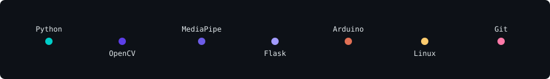

<!-- HEADER BANNER -->


<p align="center">
  
</p>

<p align="center">
  <a href="https://linkedin.com/in/pranav-prasad-94a36138b">
    
  </a>&nbsp;
  <a href="mailto:cb.en.u4cce25132@cb.students.amrita.edu">
    
  </a>&nbsp;
  <a href="https://github.com/pranavprasad25">
    
  </a>&nbsp;
  
</p>

<br />

---

## `$ whoami`

```python
class PranavPrasad:
    school        = "Amrita Vishwa Vidyapeetham, Coimbatore"
    degree        = "B.Tech · Computer & Communication Engineering"
    cgpa          = 8.90
    grad          = 2029

    focus         = ["Agentic AI", "LLM Applications", "MCP", "IoT", "Computer Vision"]
    obsession     = "AI x Embedded — most people pick one. I do both."

    currently     = "shipping things before fully understanding them, then understanding them"

    def what_drives_me(self):
        return (
            "I like systems that blur the line between software and hardware. "
            "AI agents that talk to sensors. Models that run on edge. "
            "Stuff that actually does something in the physical world."
        )
```

<br />

---

## project constellation ✦

<sub>not a roadmap — just the trail my work keeps drawing</sub>

<br />

<table>
<tr>
<td width="50%" valign="top">

`IoT · AI/ML · sensors` &nbsp; *ongoing*

### 🔥 ThermoShift

AI-powered thermal management that monitors temperature data and dynamically optimizes cooling for improved efficiency and performance.

   

</td>
<td width="50%" valign="top">

`CV · voice · agents`

### 👋 Gesture AI Assistant

Hands-free control of mouse, volume, screenshots, and media via hand gestures + voice assistant + Flask dashboard.

   

</td>
</tr>

<tr>
<td width="50%" valign="top">

`MCP · LLMs · agents`

### 🧠 HealthOS AI

AI healthcare platform for health records, prescription analysis, medication reminders, and personalized health insights.

   

</td>
<td width="50%" valign="top">

`robotics · embedded · AI` &nbsp; *ongoing*

### 🤖 PacBot

Autonomous robotics platform combining sensors, embedded programming, and AI to navigate and operate in real-world environments.

    

</td>
</tr>

<tr>
<td width="50%" valign="top">

`IoT · CV · ML` &nbsp; *ongoing*

### 🏭 Conveyor Health Monitor

IoT + AI system where computer vision detects cracks, tears, and misalignment, with ML models learning operating patterns for predictive maintenance.

   

</td>
<td width="50%" valign="top">

`FPGA · digital-design` &nbsp; *ongoing*

### 💡 Logic Quest

FPGA and digital-design focused learning track — Verilog, RISC-V architecture, CPU design, digital circuits, PWM, and frequency scaling.

   

</td>
</tr>
</table>

<br />

---

## stack

<sub>tools I actually reach for</sub><br/>
<sub>not a census. just the recurring cast.</sub>

<br />



<br />

<table>
<tr>
<td valign="top" width="33%">

**languages**


</td>
<td valign="top" width="33%">

**AI · ML · agents**


</td>
<td valign="top" width="33%">

**embedded · IoT**


</td>
</tr>
</table>

<br />

---

## numbers

<p align="center">
  
  &nbsp;&nbsp;
  
</p>

<br />

<p align="center">
  
  
  
  
  
</p>

<br />

---

<!-- FOOTER -->

