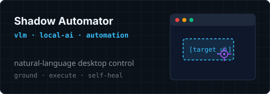
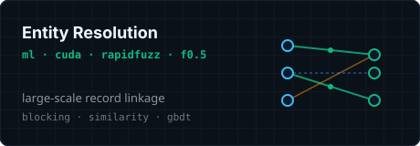
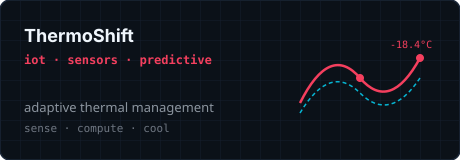
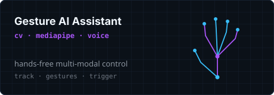
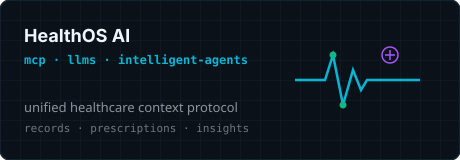
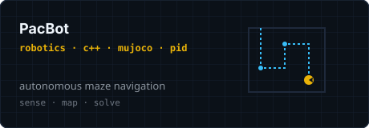
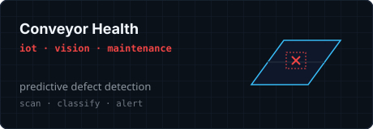
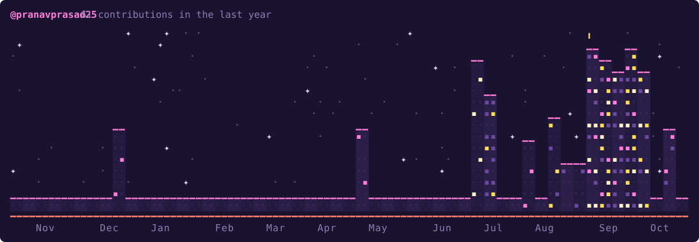

<!-- HEADER BANNER -->


<p align="center">
  
</p>

<p align="center">
  <a href="https://linkedin.com/in/pranav-prasad-94a36138b">
    
  </a>&nbsp;
  <a href="mailto:cb.en.u4cce25132@cb.students.amrita.edu">
    
  </a>&nbsp;
  <a href="https://github.com/pranavprasad25">
    
  </a>&nbsp;
  
</p>

<br />

---

## `whoami`

```python
class PranavPrasad:
    degree = "B.Tech · Computer & Communication Engineering"

    building = [
        "Agentic AI & LLM Systems",
        "AI Agents & MCP",
        "Computer Vision",
        "Intelligent Automation",
        "AIoT & Embedded Systems",
    ]

    exploring = ["Local AI", "RAG", "Robotics", "Edge Intelligence"]

    obsession = "AI x Embedded — most people pick one. I do both."

    current = "Turning impossible-sounding ideas into working systems."
```

<br />

---

## Projects

<br />

<table>
<tr>
<td width="50%" valign="top">



### Shadow Automator
*Privacy-First, AI-Powered Desktop Automation Agent*

A privacy-first, AI-powered desktop automation agent that converts natural-language instructions into executable, multi-step workflows. It combines vision-language models (VLMs), local LLM inference, computer vision, GUI automation, and visual state validation to operate desktop applications through natural-language commands.

Instead of relying on hardcoded screen coordinates or manually scripted interactions, the system captures the desktop, identifies UI elements from visual context, determines where actions should occur, and executes mouse and keyboard operations with self-healing feedback loops.

<p align="left">
  
  
  
  
  
</p>

[**➜ [ access repository ]**](https://github.com/pranavprasad25)

</td>
<td width="50%" valign="top">



### Amazon ML Challenge 2026
*High-Performance, GPU-Accelerated Business Entity Resolution*

Developed a scalable machine learning pipeline for Business Entity Resolution (ER), identifying matching business records across multiple independent data sources without relying on shared unique identifiers.

The system addresses inconsistencies in business names, legal suffixes, addresses, postal codes, and geographical information using text normalization, multi-key candidate blocking, fuzzy similarity metrics, and GPU-accelerated gradient-boosted classifiers.

<p align="left">
  
  
  
  
</p>

[**➜ [ access repository ]**](https://github.com/pranavprasad25/ML-HACK)

<details>
<summary><b>⚙️ Technical Architecture & Benchmarks</b></summary>

<br>

#### 1. Data Preprocessing and Normalization
Unicode NFKD normalization, lowercasing, regex address expansions (e.g. *Pvt Ltd* vs *Private Limited*), and country-specific postal code parsers (India, USA, France).

#### 2. Multi-Key Candidate Blocking
Five inverted-index strategies avoid exhaustive pairwise comparisons across large datasets using compound keys, significant name tokens, exact postal codes, phonetic Soundex, and 3-character prefixes.

#### 3. Pairwise Feature Engineering
16-feature similarity vectors using RapidFuzz (Levenshtein, Jaro-Winkler, token similarity, Jaccard, digit overlap, and exact postal matching).

#### 4. GPU-Accelerated Machine Learning
XGBoost and LightGBM classifiers trained with 5-fold stratified cross-validation, negative sampling for class imbalance, and NVIDIA CUDA acceleration.

#### 5. Precision-Focused Threshold Optimization
Predictions optimized against Macro F0.5, sweeping decision thresholds to minimize false merges while preserving match coverage.

#### Reported Benchmarks (RTX 5060 · 28 CPU Cores · 16 GB RAM)
| Stage | Workload | Reported Runtime |
| :--- | :--- | :--- |
| Preprocessing | 17.6 million rows | ~3.7 minutes |
| Candidate Blocking | 5.1 million test rows | ~1.5 minutes |
| Feature Extraction & Inference | ~40 million pairs | ~3 minutes |
| **End-to-End Pipeline** | **Full dataset** | **~7–9 minutes** |

</details>

</td>
</tr>

<tr>
<td width="50%" valign="top">



### ThermoShift
*Predictive Thermal Management Platform*

AI-powered thermal management system that monitors live multi-point temperature telemetry and dynamically optimizes cooling duty cycles for improved efficiency and hardware performance.

<br />

<p align="left">
  
  
  
  
</p>

[**➜ [ access repository ]**](https://github.com/pranavprasad25/ThermalCore)

</td>
<td width="50%" valign="top">



### Gesture AI Assistant
*Vision-Based Human-Computer Interface*

Hands-free control of mouse navigation, volume levels, screenshots, and media playback via real-time 21-point hand landmark estimation coupled with an integrated voice assistant.

<br />

<p align="left">
  
  
  
</p>

[**➜ [ access repository ]**](https://github.com/pranavprasad25/Gesture-AI-Assistant)

</td>
</tr>

<tr>
<td width="50%" valign="top">



### HealthOS AI
*Agentic Healthcare Orchestration via MCP*

AI healthcare platform leveraging the Model Context Protocol (MCP) to unify electronic health records, prescription extraction, medication safety alerts, and personalized clinical insights.

<br />

<p align="left">
  
  
  
  
</p>

[**➜ [ access repository ]**](https://github.com/pranavprasad25/Healthos-Ai)

</td>
<td width="50%" valign="top">



### PacBot
*Autonomous Robotics Navigation & Simulation*

Autonomous robotics platform combining low-latency sensor fusion, embedded C++ control loops, and simulated physics in MuJoCo for real-time maze exploration and path planning.

<br />

<p align="left">
  
  
  
  
  
</p>

[**➜ [ access repository ]**](https://github.com/pranavprasad25)

</td>
</tr>

<tr>
<td width="50%" valign="top">



### Conveyor Health Monitor
*Industrial Computer Vision & IoT Inspection*

IoT and computer vision system detecting belt surface micro-cracks, tears, and tracking misalignment in real time, with machine learning models providing predictive maintenance alerts.

<br />

<p align="left">
  
  
  
  
</p>

[**➜ [ access repository ]**](https://github.com/pranavprasad25)

</td>
<td width="50%" valign="top">

<br />

### ➕ Add New Repository
*Easily showcase your latest build or repository*

<details>
<summary><b>[ copy card template ]</b></summary>

<br>

```html
<td width="50%" valign="top">


### Project Title
*Domain · Focus*

Concise 2-3 sentence overview of the architecture and impact.

<p align="left">
  
  
</p>

[**➜ [ access repository ]**](https://github.com/pranavprasad25/your-repo)

</td>
```

</details>

<br />

<p align="center">
  <a href="https://github.com/pranavprasad25?tab=repositories">
    
  </a>
</p>

</td>
</tr>
</table>

<br />

---

## Stack

<br />

### AI / ML
<p align="left">
  
  
  
  
  
</p>

### Vision
<p align="left">
  
  
</p>

### Systems
<p align="left">
  
  
</p>

### Embedded / IoT
<p align="left">
  
  
  
</p>

### Dev
<p align="left">
  
  
</p>

<br />

---

## Github Telemetry

<div align="center">



</div>

<br />

---

<!-- FOOTER -->

